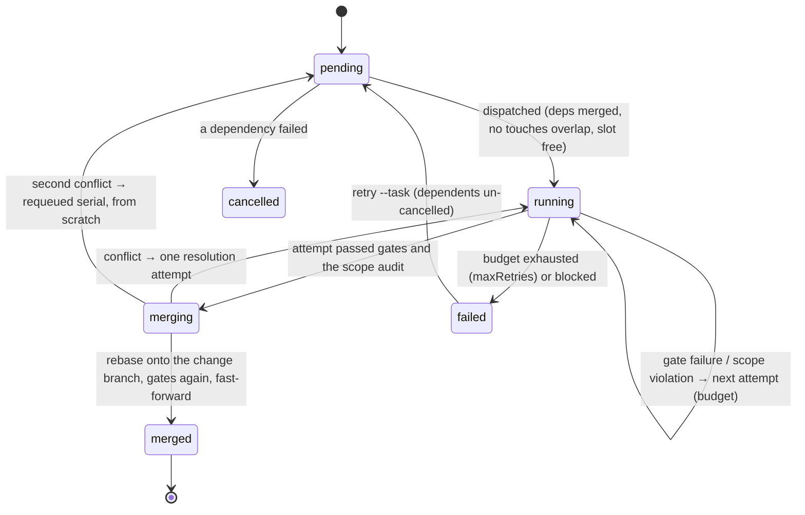

# Architecture

ai-factory is a CLI that turns a request into a spec, waits for one human approval, then implements, reviews and tests the change with opencode agents. Everything happens in local git: nothing is pushed. This document covers how the parts fit together. The reasons behind each choice are in [docs/decisions/](docs/decisions/), and command details in [docs/cli.md](docs/cli.md).

## Components

```mermaid
flowchart LR
  user([You]) -->|run / approve / resume / status| cli

  subgraph cli[ai-factory CLI]
    direction TB
    pipeline[pipeline<br/>intake · design · implement<br/>review · contracts · full suite · close]
    scheduler[scheduler<br/>task DAG · maxAgents · retries]
    gates[gates<br/>resolve · run · check-only guard]
    gitmod[git<br/>branches · worktrees · merge queue · pointers]
    contracts[contracts<br/>OpenAPI · JSON Schema · Helm · proto]
    state[state<br/>runs · active lock · queue · approvals]
    usage[usage ledger]
    managed[managed files<br/>render · lock · update · rollback]
    pipeline --> scheduler --> gates
    scheduler --> gitmod
    pipeline --> contracts
    pipeline --> state
  end

  subgraph oc[opencode serve, one private server per run]
    agents[agents<br/>orchestrator · architect · explorer<br/>implementer-&lt;repo&gt; · tester · reviewer · contract-reviewer]
    plugin[factory plugin<br/>execute.before guard + logs]
    agents --- plugin
  end

  cli -->|REST + SSE, model per role| oc
  cli -->|validate · archive · init| openspec[OpenSpec CLI]
  cli -->|update, serialised after each merge| graphify[Graphify]
  agents -->|graphify query| graph[(graphify-out/graph.json)]
  graphify --> graph
  plugin -->|reads| sessions[(.factory/sessions)]
  cli -->|writes| sessions
  gitmod --> repos[(AI repo + submodules<br/>change/&lt;id&gt; branches<br/>task worktrees)]
  agents -->|edit within scope| repos
  usage -.-> oc
```

| Part             | Where                                                                             | Notes                                                                                                                                                                           |
| ---------------- | --------------------------------------------------------------------------------- | ------------------------------------------------------------------------------------------------------------------------------------------------------------------------------- |
| CLI              | `src/cli/`, one file per command group                                            | Bun/TypeScript, bundled to `dist/cli.js` for `npx`/`bunx`. External input is checked with zod. Child processes go through `src/exec.ts`.                                        |
| Pipeline         | `src/pipeline/`                                                                   | `drive.ts` is the state machine below. Every phase is idempotent and persisted.                                                                                                 |
| Scheduler        | `src/scheduler/`, `src/tasks/`                                                    | Parses `tasks.md` (`repo`/`deps`/`touches` metadata) into a DAG. It dispatches up to `maxAgents` sessions and serialises overlapping `touches`.                                 |
| Gates            | `src/gates/`, `src/profiles/`                                                     | Resolution order: override, then the repo's own script, then the stacked profile defaults. A gate that modifies files fails.                                                    |
| Git              | `src/git/`                                                                        | Change branches, task worktrees, the per-repo merge queue, provisional pointers, `repoint` and the `pre-push` hook.                                                             |
| Runtime          | `src/runtime/`                                                                    | One private `opencode serve` per CLI run, with a curated env (only the named providers' credentials). The model is passed per session, and every permission prompt is rejected. |
| Plugin           | `src/plugin/entry.ts`, rendered as `.opencode/plugins/factory.js`                 | It shares its policy code with the CLI (`src/policy/`, `src/approval/`).                                                                                                        |
| OpenSpec         | `src/openspec/`                                                                   | Runs `validate --strict --json` and `archive --yes`. Telemetry is off and `XDG_CONFIG_HOME` is private.                                                                         |
| Graph            | `src/graph/`                                                                      | One graph covers the AI repo and its submodules. Updates are serialised and coalesced after merges, and run with `GRAPHIFY_NO_AUTO_REFRESH=1 GRAPHIFY_BACKEND=none`.            |
| Install / update | `src/render/`, `src/managed/`, `src/workspace/`, `src/update/`, `src/migrations/` | `factory.lock.json` records each managed file's hash and git blob, which serves as the merge base for `update`.                                                                 |
| Add-ons          | `src/addons/`                                                                     | Ponytail is vendored at a pinned commit and hash-verified. It is injected only into the implementer and reviewer prompts.                                                       |
| Doctor           | `src/doctor/`                                                                     | Read-only checks, including the resolved gate table.                                                                                                                            |

### Files in a workspace

| Path                                                       | Committed | Written by                                                                              |
| ---------------------------------------------------------- | --------- | --------------------------------------------------------------------------------------- |
| `factory.config.jsonc`                                     | yes       | `init`; you; `detect --apply`; `update` (migrations)                                    |
| `factory.lock.json`                                        | yes       | `init`, `update`, `detect --apply` only                                                 |
| `.opencode/` (agents, plugin, standards, schemas, add-ons) | yes       | managed files, including OpenSpec's generated commands and skills                       |
| `AGENTS.md`, `.gitignore`                                  | yes       | your text plus a managed block between `ai-factory` markers                             |
| `openspec/changes/<id>/`                                   | yes       | architect (spec), CLI (checkbox mirror, archive)                                        |
| `.factory/runs/<id>.json`                                  | no        | CLI only: phase, tasks, attempts, history                                               |
| `.factory/runs/<id>/snapshot/gates.json`                   | no        | `approve`: gate config + profile tables the change keeps                                |
| `.factory/active.lock`, `.factory/queue.json`              | no        | the one active change and the approval-ordered queue                                    |
| `.factory/approvals/<id>.json`                             | no        | `approve`: approver, spec commit, spec hash                                             |
| `.factory/worktrees/<id>/<repo>/<task>/`                   | no        | task worktrees (and `.factory/worktrees/<id>/.opencode/agents`, the snapshotted agents) |
| `.factory/drafts/<id>/`                                    | no        | AI-repo worktree for a change designed while another one is active                      |
| `.factory/context/<id>/`                                   | no        | context packs (architect)                                                               |
| `.factory/sessions/`                                       | no        | one file per agent session: role, scope, worktree; the plugin reads it                  |
| `.factory/logs/`, `.factory/usage/`, `.factory/reports/`   | no        | redacted tool and gate logs, the token ledger, final and pause reports                  |
| `.factory/cache/`                                          | no        | shared package stores and build caches for worktree installs                            |
| `.factory/backups/<ts>/`                                   | no        | `update` backups for `rollback`                                                         |
| `graphify-out/`                                            | no        | the workspace graph                                                                     |

## Pipeline state machine

```mermaid
stateDiagram-v2
  [*] --> intake: ai-factory run
  intake --> design: orchestrator picks id, explorers map the repos
  design --> design: validate / tasks / DAG problems → repair round (≤ maxRetries)
  design --> awaiting_approval: spec valid
  design --> paused: still invalid
  awaiting_approval --> queued: approve (hash + spec commit)
  queued --> implementing: active lock claimed (now, or when the active change closes)
  implementing --> reviewing: all tasks merged
  reviewing --> implementing: must/should findings → fix tasks
  reviewing --> contracts: no findings left
  contracts --> implementing: gate fails → one fix round; review findings → fix tasks
  contracts --> full_suite: contract gate + contract review pass
  full_suite --> implementing: failures → suite fix tasks (≤ 2 rounds)
  full_suite --> closing: all suites pass
  closing --> done: checkboxes, pointer bump, archive, report
  implementing --> paused: task failed after retries / blocked
  full_suite --> paused: still failing after 2 rounds
  paused --> implementing: retry --task / resume
  intake --> aborted: abort
  implementing --> aborted: abort
  aborted --> implementing: resume
  done --> [*]
```

The phase lives in `.factory/runs/<id>.json`. `resume` re-enters at the recorded phase. Pauses (gate budget exhausted, a blocked task, design not converging, an interrupt) keep everything on disk.



The diagram writes `awaiting-approval` as `awaiting_approval` and `full-suite` as `full_suite`, because the diagram syntax needs it. `approve` is the only human gate. It hashes the spec (task checkboxes are normalised out of the hash) and commits it as `docs(spec): <id>`. Before any implementation edit, the CLI and the plugin both re-check the hash, and that the spec commit is on `change/<id>`.

### Task state machine



## Enforcement matrix

Layers, from the agent's side outward:
- **Plugin.** It checks each tool call before it runs: a parsed shell blocklist, edit scopes and the approval hash. Its `shell create.before` hook lets only those approved commands spawn, scrubs credentials and wraps each shell in the sandbox.
- **opencode permissions.** Static allow/deny rules per agent.
- **OS sandbox.** macOS `sandbox-exec`. It governs whatever program a command starts, however it was written.
- **CLI.** The post-session audit, gates, the approval check and owned state.
- **git.** The agent environment rewrites every push URL, and the `pre-push` hook rejects agent pushes.

The parser judges what a command _says_. The sandbox enforces what any program it starts may _do_. So a rule that only the parser covers is a best-effort rule wherever there is no sandbox (Linux today). ADR-0018 and ADR-0026 have the details, and the 2026-10-26 audit lists what was found and fixed.

| Rule                                                                                                                          | Plugin                                                                                    | opencode permissions                   | OS sandbox (macOS)                                           | CLI                                                                                       | git                                  |
| ----------------------------------------------------------------------------------------------------------------------------- | ----------------------------------------------------------------------------------------- | -------------------------------------- | ------------------------------------------------------------ | ----------------------------------------------------------------------------------------- | ------------------------------------ |
| No `git push`                                                                                                                 | parsed blocklist (incl. `-c`/env/option evasions)                                         | `git push*` deny                       | no credential helpers, no port 22                            | gates and installs get the push block too                                                 | push URLs rewritten, `pre-push` hook |
| Other blocked shell (force, history rewrite, ref/branch deletion, remote and config writes, sudo, `curl \| sh`, `rm` outside) | parsed blocklist, incl. keywords, `cd`, `xargs`, `exec`, here-docs, interpreters, awk/sed | coarse deny patterns                   | writes outside the session's directories fail                | —                                                                                         | —                                    |
| Edit scope per role                                                                                                           | `checkEdit` on the named **and** the real path (symlinks)                                 | `edit` allow/deny per role             | writes limited to the worktree (architect: its two folders)  | post-session audit against where the session started; agent commits are folded back first | —                                    |
| Factory files never edited (incl. single-repo `.`)                                                                            | protected paths, case-insensitive                                                         | protected-path denies (case-sensitive) | factory files and `.git` read-only inside the worktree       | audit, `init`/`update` hash checks                                                        | —                                    |
| No implementation before approval                                                                                             | approval hash check                                                                       | —                                      | —                                                            | dispatch only after the hash and spec-commit check; the audit uses the real check         | —                                    |
| Run state, approvals, session context only by the CLI                                                                         | `.factory/**` protected; each session's context pinned at first read                      | `.factory/*` deny                      | the workspace outside the session's directories is read-only | state written only by the CLI                                                             | —                                    |
| Secret files                                                                                                                  | read/edit/shell checks on real paths                                                      | read/edit denies                       | credential files under `$HOME` unreadable                    | log redaction; credentials scrubbed from shells, gates and installs                       | —                                    |
| The server password                                                                                                           | —                                                                                         | —                                      | —                                                            | not in shell environments; non-factory agents and REST shells refused                     | —                                    |
| Gates check honestly                                                                                                          | —                                                                                         | —                                      | gates sandboxed                                              | check-only guard; a task may not change the scripts or targets its gates run              | —                                    |
| Graph updates only by the CLI                                                                                                 | `graphify update/extract/hook/install` blocked                                            | coarse denies                          | —                                                            | serialised, coalesced updates                                                             | —                                    |
| Retry budget (3)                                                                                                              | —                                                                                         | —                                      | (state is read-only to agents)                               | scheduler                                                                                 | —                                    |
| One active change                                                                                                             | —                                                                                         | —                                      | —                                                            | `.factory/active.lock` and the queue                                                      | —                                    |
| Ponytail integrity                                                                                                            | —                                                                                         | —                                      | —                                                            | content hash in `init`/`update`                                                           | —                                    |
| Running change unaffected by `update --force`                                                                                 | —                                                                                         | —                                      | —                                                            | snapshotted agents and gate tables                                                        | —                                    |
| Prompt injection                                                                                                              | instructions in files are never executed; every call is logged                            | —                                      | limits what an injected command can reach                    | prompts mark repo content as untrusted                                                    | —                                    |
| Usage never blocks                                                                                                            | —                                                                                         | —                                      | —                                                            | the ledger is report-only                                                                 | —                                    |

**Known limits.**
- **No sandbox outside macOS.** On Linux the parser is still the main guard for shell commands. Python, Node and other programs an agent writes are not inspected there.
- **Planted tools.** A tool an agent drops into `node_modules/.bin` can fake a gate result. It cannot push, read credentials or touch state outside its worktree.
- **Reachable writes.** Writes elsewhere under `$HOME` or into temp directories are not blocked.
- **Tokens in remote URLs.** A remote URL with an embedded token would still let a push through if an agent got past every other layer.

## Git model

Branches and commits for one change `<id>`:

| Repo                                        | Branch                                                                         | Commits, in order                                                                                                                                                                                             |
| ------------------------------------------- | ------------------------------------------------------------------------------ | ------------------------------------------------------------------------------------------------------------------------------------------------------------------------------------------------------------- |
| AI repo                                     | `change/<id>`, created **before design**                                       | `docs(spec): <id>` at approval. At close: `chore(submodules): bump for <id> [provisional]` (submodule layout), then `chore(spec): archive <id>`. After the upstream merges: `chore(submodules): repoint <id>` |
| each touched submodule (or the single repo) | `change/<id>`, created from the checked-out commit (also from a detached HEAD) | one Conventional Commit per task (`feat:`/`fix:`/`test:`…) with `Change-Id: <id>` and `Task: <n>` trailers, fast-forwarded in merge-queue order                                                               |
| per task                                    | `change/<id>--<task>` in a worktree                                            | deleted after its fast-forward (`git branch -d`)                                                                                                                                                              |

Every commit is local. You push and open merge requests yourself. Afterwards `ai-factory repoint <id>` fetches each submodule and finds where its change landed upstream: a fast-forward, a merge commit, the `Change-Id` trailer after a rebase merge, or the patch-id of a squash. It then commits the real pointers.

### Submodule worktree commands

Task worktrees are created from each repo's **own** git dir, so a submodule works exactly like a single repo. For a submodule at `repos/backend` and task `1.2` of change `add-search` (`<ws>` is the workspace root):

```sh
# change branch in the submodule (once per change; works from a detached HEAD)
git -C repos/backend switch -c change/add-search

# task worktree off the current tip of the change branch
git -C repos/backend worktree prune
git -C repos/backend worktree add -q -b change/add-search--1.2 \
    <ws>/.factory/worktrees/add-search/backend/1.2 change/add-search

# merge queue, one task at a time per repo (repos merge in parallel)
git -C <ws>/.factory/worktrees/add-search/backend/1.2 rebase change/add-search
#   … task gates run again in the worktree …
git -C repos/backend merge --ff-only change/add-search--1.2

# cleanup after the fast-forward
git -C repos/backend worktree remove <ws>/.factory/worktrees/add-search/backend/1.2
git -C repos/backend branch -q -d change/add-search--1.2

# close: provisional pointer bump in the AI repo
git add repos/backend repos/frontend
git commit -m "chore(submodules): bump for add-search [provisional]" -m "Change-Id: add-search"
```

The worktree metadata lives in `.git/modules/repos/backend/worktrees/`. Dependency installs in a new worktree use the shared stores under `.factory/cache/` (`npm_config_cache`, `BUN_INSTALL_CACHE_DIR`, `UV_CACHE_DIR`, `GOMODCACHE`, `CARGO_TARGET_DIR`, …). Install time and install failures never count against the retry budget.

## Agents and the runtime

- **Roles and models.** Each role gets its model from `models` in the config. The CLI passes the model on every session, because opencode ignores the agent frontmatter `model`. Strong models plan and review, and faster ones implement.
- **Implementers.** There is one implementer per repo (`implementer-<repo>`), with the repo's language standards stacked into its prompt. The tester works only on test paths.
- **Read-only roles.** The orchestrator, explorer, reviewer and contract-reviewer only read. The architect edits only the change folder and its context folder.
- **Sessions.** Every agent call is a fresh session in a known directory: a task worktree, a repo checkout or the root. The CLI writes a session context file first; the plugin refuses any factory agent that has none.
- **Handoffs.** Agents end with a JSON handoff that is validated against `.opencode/schemas/handoff.schema.json`. An invalid handoff gets one repair turn.
- **Token use.** Prompts put stable text first so it can be cached. Context packs are capped at `contextPackMaxTokens`, and gate output is compacted. Usage per agent, task and change is reported in `status` and in the final report, and never enforced.

## Updates

`update` migrates the config (`src/migrations/NNN-*.ts`, which edit text and keep comments). It then re-renders the managed files: files you didn't edit are replaced, files you edited are merged three-way against the lock's blob, and files you deleted stay deleted. Before writing, it backs everything up, and it finishes as one commit. `rollback` restores the backup. A change that is already running keeps its snapshotted definitions. See ADR-0022 and [CHANGELOG.md](CHANGELOG.md).
